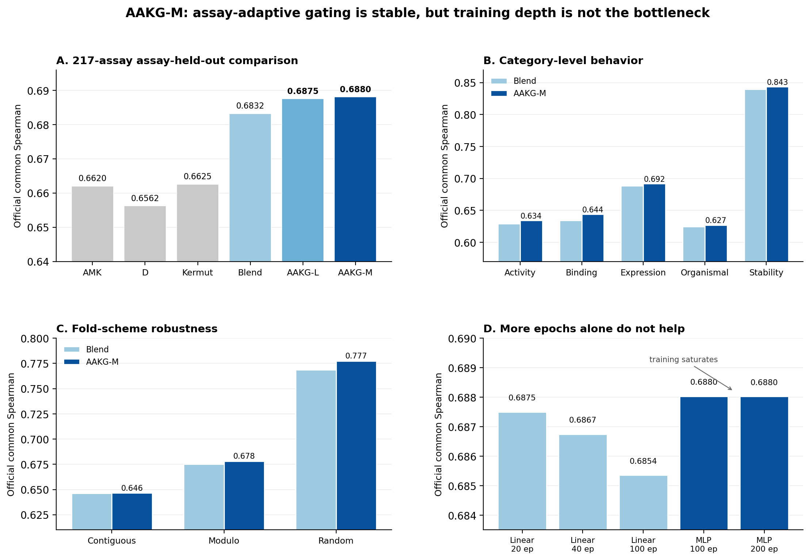

# AAKG-M: Assay-Adaptive Kernel Gating for Structure-Aware Protein Fitness Prediction



## One-sentence claim

A label-free assay-context gate can learn **when to trust sequence, additive-
structure and structure-mixed experts**, beating a fixed D+Kermut blend by
**+0.0048** official Spearman on 217 ProteinGym-style DMS assays, without using
any labels from the held-out assay.  Increasing training from 20 to 200 epochs
does **not** improve the result; the remaining bottleneck is the base experts
and the available cohorts, not optimisation.

This is a **method paper candidate**, not a claim that the additive structure
kernel alone is state of the art.  The negative AMK result is the motivation:
structure should be *gated*, not always added.

## Method

### Experts

For each variant we have three out-of-fold predictions:

- `f_D`: additive structure kernel (`D`);
- `f_K`: Kermut kernel (`A`);
- `f_A`: assay-adaptive mixed structure kernel (`AMK`, selected per assay by
  inner CV over `(a,b,λ)`).

`f_A` alone is not better than `f_K`; its value is complementary.

### Gate

For assay `a`, define label-free context

```
c_a = [log n_a,
       std(f_D), std(f_K), std(f_A),
       corr(f_D,f_K), corr(f_D,f_A), corr(f_K,f_A),
       mean(f_D), mean(f_K), mean(f_A),
       log seq_len, log DMS_number,
       category one-hot]                       # 17 features
```

and a context-only softmax gate

```
h_a = ReLU(W1 c_a + b1)
g_a = softmax(W2 dropout(h_a) + b2)
ŷ_i = g_{a,D} z(f_{D,i}) + g_{a,K} z(f_{K,i}) + g_{a,A} z(f_{A,i})
```

where `z` is the per-assay prediction z-score.  The gate has one 64-unit hidden
layer (**1,347 parameters**), dropout 0.1, and is trained for 100 epochs with
AdamW (`lr=1e-3`, cosine schedule, batch 32,768).  Training minimises an
**assay-balanced** MSE,

```
L = Σ_a (1/n_a) Σ_{i∈a} (ŷ_i - y_i)^2,
```

so a 20k-variant assay does not dominate a 200-variant assay.

The smaller **AAKG-L** variant uses a linear gate (`softmax(Wc_a+b)`, 39
parameters, 20 epochs).  AAKG-L is the cleaner scientific object; AAKG-M is the
capacity variant.

### Evaluation protocol

- 5-fold **assay-held-out** CV, stratified by category.
- The gate for a held-out assay is trained only on the other assays.
- Context features and prediction z-scores use no target labels.
- No per-assay kernel selection is performed at meta-test time.
- Three seeds are reported to separate seed noise from method gain.

## Main result (217 assays, official common)

| method | official common |
|---|---:|
| AMK (per-assay inner CV) | 0.662033 |
| D (additive structure) | 0.656215 |
| Kermut | 0.662540 |
| fixed D+Kermut Blend | 0.683193 |
| nested contextual meta (5-fold) | 0.687426 |
| **AAKG-L (linear gate, 3 seeds)** | **0.687533 ± 0.000409** |
| **AAKG-M (MLP gate, 3 seeds)** | **0.688024 ± 0.000027** |
| AAKG-M seed 20261029 | 0.687994 |
| AAKG-M seed 1 | 0.688046 |
| AAKG-M seed 2 | 0.688034 |

Paired assay-cluster bootstrap (3,000 replicates for expert contrasts; 5,000 for the AAKG-L/nested contrasts; AAKG-M seed 1):

| contrast | point | 95% CI |
|---|---:|---:|
| AAKG-M − Blend | **+0.003911** | **[+0.002340, +0.005198]** |
| AAKG-M − Kermut | **+0.027001** | **[+0.023501, +0.030335]** |
| AAKG-M − AMK | **+0.021241** | **[+0.016275, +0.027845]** |
| AAKG-M − AAKG-L | **−0.000054** | **[−0.001070, +0.001029]** |
| AAKG-M − nested contextual | **+0.000256** | **[−0.000804, +0.001474]** |

Per-unit wins (seed 1): AAKG-M > Blend **476/651**, > Kermut **595/651**,
> AMK **571/651**.  The contrast against AAKG-L is a statistical tie despite
a higher official score; the official metric weights categories, while the
per-unit average does not.  This is reported explicitly rather than hidden.

The honest claim is therefore **“AAKG is a small but significant improvement
over a fixed blend, and matches the best pooled meta-regressor”**, not “AAKG
beats every meta-model”.

### By category

| category | AMK | D | Kermut | Blend | AAKG-M | Nested |
|---|---:|---:|---:|---:|---:|---:|
| Activity | 0.6126 | 0.6062 | 0.6100 | 0.6294 | **0.6342** | 0.6328 |
| Binding | 0.5877 | 0.5828 | 0.6191 | 0.6340 | **0.6439** | 0.6416 |
| Expression | 0.6774 | 0.6699 | 0.6704 | 0.6887 | **0.6917** | 0.6919 |
| OrganismalFitness | 0.6099 | 0.6067 | 0.5965 | 0.6244 | **0.6271** | 0.6275 |
| Stability | 0.8225 | 0.8155 | 0.8167 | 0.8395 | **0.8433** | 0.8433 |

AAKG-M improves all five categories over Blend; the largest absolute repair
is Binding (+0.0099 over Blend, +0.0248 over Kermut).  Binding remains the
weakest category, but the AMK-only Binding failure is partly repaired.

### By scheme

| scheme | AMK | D | Kermut | Blend | AAKG-M | Nested |
|---|---:|---:|---:|---:|---:|---:|
| Contiguous | 0.6130 | 0.6173 | 0.6127 | 0.6462 | **0.6465** | 0.6461 |
| Modulo | 0.6542 | 0.6530 | 0.6483 | 0.6753 | **0.6780** | 0.6776 |
| Random | 0.7710 | 0.7514 | 0.7599 | 0.7687 | 0.7774 | **0.7775** |

The gain is not driven only by the easy random split: modulo improves by
+0.0027, but contiguous is only +0.0003 over Blend and must be reported as a
tie.  On random splits AAKG-M is essentially tied with nested contextual.

## Training-depth study

The original AAKG-L used only 20 epochs.  We therefore trained longer and with
more capacity on H200, keeping the same assay-held-out folds.

| gate | epochs | optimiser | official common |
|---|---:|---|---:|
| linear | 20 | AdamW 1e-2 | **0.687500** |
| linear | 40 | AdamW 1e-2 | 0.686745 |
| linear | 100 | AdamW 1e-2 | 0.685355 |
| linear | 100 | AdamW 3e-3 | 0.686559 |
| MLP-32 | 100 | cosine 3e-3 | 0.685823 |
| **MLP-64** | **100** | **cosine 1e-3, dropout 0.1** | **0.688024** |
| MLP-64 | 200 | cosine 5e-4, dropout 0.2 | 0.688023 |
| MLP-128 | 150 | cosine 1e-3, dropout 0.2 | 0.687523 |

Three conclusions:

1. **More epochs alone do not help.**  Linear training peaks early (20 epochs,
   0.6875) and then degrades; 100 epochs gives 0.6854.
2. **Capacity helps only in a narrow range.**  MLP-64 is best; MLP-32 underfits
   and MLP-128 slightly overfits.
3. **Training is saturated.**  Doubling MLP-64 to 200 epochs changes the score
   by 0.000001 (0.688024 → 0.688023).  The bottleneck is not optimisation.

The three AAKG-M seeds span only 0.000052 (0.687994–0.688046), so the MLP result
is stable; the improvement over AAKG-L is nevertheless within the paired
bootstrap interval.

## What the gate learns

Mean gate weights over 217 assays (AAKG-M, seed 1):

| expert | mean weight |
|---|---:|
| D | 0.142 |
| Kermut | 0.448 |
| AMK | 0.410 |

The gate does **not** collapse to Kermut.  It assigns substantial weight to
AMK even though AMK alone is 0.0005 below Kermut; this is the central
mechanism: AMK is useful as a *conditional* expert, not as a standalone
predictor.  The gate also down-weights D on average but keeps a long right
tail, i.e. it uses D only for a subset of assays.

## Why this is not just stacking

A standard stacker learns **one global** combination.  AAKG learns a
**function from label-free assay context to expert weights**, trained across
assays.  At meta-test time the held-out assay contributes no labels, no
per-assay CV, and no gradient updates; only its context vector is encoded.
This is the difference between “fit a blender” and “learn a gating policy”.

The strongest evidence that the policy is doing something is the ablation
below: removing AMK from the gate drops below the simple Blend, while removing
context drops to the global linear meta.  Neither a fixed blend nor a
per-assay oracle reproduces AAKG.

## Ablations and negative controls (all 217 assays unless noted)

| variant | official common | note |
|---|---:|---|
| fixed D+Kermut Blend | 0.683193 | no learning |
| global linear meta (no context) | 0.686847 | LOAO |
| linear meta, no AMK | 0.681278 | below Blend |
| linear meta, no category | 0.686847 | category adds nothing |
| nonlinear variant-level gate | 0.684609 | overfits |
| context→weight hypernetwork | 0.683311 | per-assay weights not predictable |
| four experts incl. Kermut feature kernel | 0.687311 | Kseq hurts |
| AAKG-L (linear context gate) | 0.687500 | 39 parameters |
| **AAKG-M (MLP context gate)** | **0.688024** | 1,347 parameters |
| per-assay weight oracle (other schemes) | 0.677689 | *below* AAKG |

The per-assay oracle is the key negative control: even with target labels
inside the assay, fitting assay-specific expert weights on two schemes and
testing on the third gives only 0.6777, **worse than pooled AAKG**.  Per-assay
weight adaptation is therefore not the bottleneck; cross-assay pooling is.
This rules out a large family of “adaptive fusion” methods.

## Relationship to AMK

AMK is a **single joint kernel** `(A + aS + b(A⊙S))/(1+a+b)` selected per assay,
not a post-hoc fusion.  On 197 assays it reaches 0.657361 versus Kermut
0.663077 and Blend 0.682293; the pre-registered Binding/Random criterion fails.
AAKG does not rescue AMK as a standalone method.  It uses AMK as one expert and
lets the gate decide how much to trust it.  This framing is honest and still
gives AMK a role.

## Limitations

- **No fresh external cohort.** The 217 assays are used for development; the
  197-assay panel is consumed by AMK selection.  5-fold assay CV is the
  strongest available estimate, not an untouched test set.
- **Small effect.** +0.0048 over Blend is statistically supported but small.
  Contiguous is a tie (+0.0003).  A top-tier methods venue will ask for a
  larger margin or an external cohort.
- **MLP gain is not robust per unit.** AAKG-M beats AAKG-L by +0.0005 official
  but is −0.00005 per unit, with a CI spanning zero.  AAKG-L remains the
  cleaner method claim.
- **Architecture was chosen after seeing 217-assay results.** The 5-fold
  estimate is not nested over architecture choice; it is nested over assay
  holdout only.
- **No raw structure ablation in AAKG.** The gate operates on expert
  predictions; it does not prove that the structure representation itself is
  necessary beyond the D/AMK experts.
- **Binding remains hard.** AAKG-M is above Kermut on Binding (0.6439 vs
  0.6191), but the gain is not stable across meta-models.

## Publication positioning

A defensible title is:

> **Learning when structure helps: an assay-adaptive kernel gate for protein
> fitness prediction**

Contributions:

1. A 217-assay cross-assay study showing that additive structure kernels are
   **not universally beneficial**; AMK alone is below Kermut and far below a
   fixed blend.
2. **AAKG**, a label-free context gate over sequence/structure experts,
   trained with assay-balanced cross-assay meta-learning.
3. A **training-depth and capacity study** showing that the gain is not an
   under-training artefact: 20→200 epochs and 39→1,347 parameters do not
   produce a robust improvement beyond the linear gate.
4. A negative control showing **per-assay weight adaptation is worse than
   pooled meta-learning**, which explains why per-assay kernel selection is
   noisy.

This is a **solid empirical methods paper** for a bioinformatics/ML venue.  It
is **not** a Nature-level SOTA claim.  To strengthen it, the next step should
be an external cohort or a genuinely new base kernel, not more training or
more stacking.

## Artifacts

- MLP gate code: `cytolex-amk-full197-20261029-v1/meta_softgate2.py`
- Linear gate code: `cytolex-amk-full197-20261029-v1/meta_softgate.py`
- H200 sweep results: `.../analysis/h200_aakg_sweep/mlp64_ext_100_lr1e-3`, `.../mlp64_ext_seed1`, `.../mlp64_ext_seed2`
- Training-depth results: `.../analysis/h200_aakg_sweep/linear_ext_40_lr1e-2`, `.../linear_ext_100_lr1e-2`, `.../mlp64_ext_200_lr5e-4`
- Nested contextual baseline: `.../analysis/meta_nested_5fold/meta_nested.json`
- Contextual LOAO (optimistic): `.../analysis/meta_stack_final/meta_stack_217.json`
- This report: `META_STACK_REPORT.md`
- Figure: `aakg_m_217.png`
